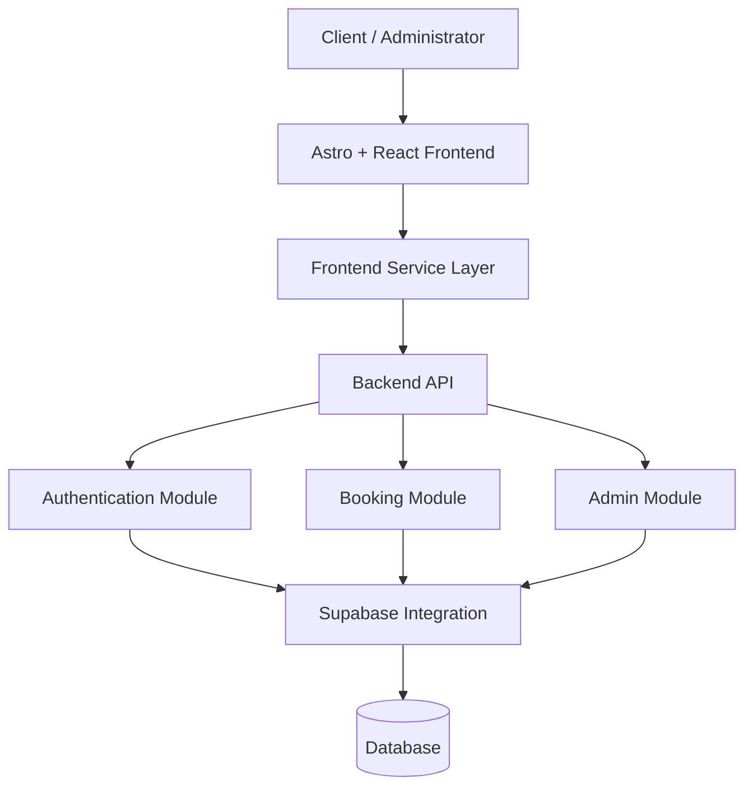

# Manicare — Beauty Salon Booking Platform

A full-stack web application for a beauty salon, combining an elegant client-facing website with an appointment booking system and an administrative interface.

Manicare is built with Astro, React, TypeScript, and Supabase, with a dedicated API layer for authentication, booking operations, and administrative functionality. The project is structured to separate the user interface, business logic, backend services, and data access.

**Live Demo:** [Manicare](https://github.com/andriydrob/manicare)

---

## Overview

Manicare is designed to simplify the way clients discover beauty services and schedule appointments while providing salon administrators with a dedicated interface for managing operations.

The application combines a service-oriented landing page with booking functionality, team and review sections, and a separate administrative area. Its architecture separates the frontend from the backend, allowing each part to evolve independently.

Rather than treating the website as a static landing page, Manicare brings together the presentation layer, API endpoints, authentication logic, and database integration in one organized application.

### Project Goals

- Create a polished digital presence for a beauty salon.
- Make salon services and team information easy to explore.
- Provide a convenient appointment booking experience.
- Separate client-facing functionality from administrative operations.
- Organize authentication and booking logic into dedicated modules.
- Maintain a codebase that can be extended with additional business features.

## Features

### Client Experience

- **Service Catalog** — A dedicated section for presenting salon services.
- **Online Booking Interface** — A booking component for initiating appointment reservations.
- **Team Showcase** — A dedicated section introducing salon professionals.
- **Client Reviews** — A section for displaying customer feedback.
- **Visual Gallery** — Image-based content that highlights the salon's atmosphere.
- **Responsive Navigation** — Navigation designed around the main website sections.
- **Quick Contact Access** — A floating phone component for convenient contact access.
- **Dedicated Landing Page** — A homepage that brings together the salon's key information.

### Booking System

- **Booking API** — A dedicated backend module for appointment-related operations.
- **Frontend Booking Layer** — A separate client-side module for communicating with the booking API.
- **Structured Request Handling** — A dedicated location for organizing booking logic.
- **Database Integration** — Supabase integration for backend data access.

The exact booking workflow, validation rules, appointment availability logic, and persistence behavior depend on the implementation in the source code.

### Authentication and Administration

- **Authentication Module** — Dedicated backend and frontend modules for authentication-related operations.
- **Administrative Interface** — A separate area for salon administration.
- **Admin API** — A dedicated backend module for administrative functionality.
- **Protected Operations** — A foundation for separating administrative actions from public-facing functionality.

Authentication, authorization, and access restrictions should be enforced on the server side rather than relying only on frontend route visibility.

## Technology Stack

| Technology | Purpose |
| --- | --- |
| [Astro](https://astro.build/) | Frontend framework, page routing, and layouts |
| [React](https://react.dev/) | Interactive interface components |
| [TypeScript](https://www.typescriptlang.org/) | Static typing across application modules |
| [Supabase](https://supabase.com/) | Backend data services and potential authentication integration |
| [Node.js](https://nodejs.org/) | Backend JavaScript runtime |
| [npm](https://www.npmjs.com/) | Dependency management |
| [Vercel](https://vercel.com/) | Deployment platform and project hosting configuration |

The project uses separate dependency manifests for the frontend and backend, supporting an independently organized development workflow.

## Architecture

Manicare follows a frontend/backend separation model.



*Conceptual architecture based on the repository structure. Exact request flows and database operations depend on the implementation.*

### Frontend

The `web/` directory contains the user interface, page definitions, reusable components, shared content, and client-side service modules.

Astro provides the page and layout structure, while React components support interactive features such as booking and administration interfaces.

### Backend

The `api/` directory contains the server entry point and dedicated modules for authentication, booking, administrative operations, and Supabase integration.

This separation helps keep request handling and business logic distinct from presentation components.

### Data Access

The `supabase.ts` module centralizes the backend's Supabase integration. Keeping database access in a dedicated module makes configuration and data operations easier to maintain.

### Deployment

The root-level `vercel.json` provides deployment configuration for Vercel. The exact routing and runtime behavior should be verified against its contents and the application configuration.

## Project Structure

```text
manicare/
├── api/
│   ├── src/
│   │   ├── admin.ts
│   │   ├── auth.ts
│   │   ├── booking.ts
│   │   ├── server.ts
│   │   └── supabase.ts
│   ├── package-lock.json
│   ├── package.json
│   └── tsconfig.json
│
├── web/
│   ├── public/
│   │   ├── team/
│   │   └── salon.jpg
│   │
│   ├── src/
│   │   ├── components/
│   │   │   ├── AdminPanel.tsx
│   │   │   ├── Booking.tsx
│   │   │   ├── FloatingPhone.tsx
│   │   │   ├── Footer.astro
│   │   │   ├── Header.tsx
│   │   │   ├── Hero.tsx
│   │   │   ├── Photoslot.tsx
│   │   │   ├── Reviews.tsx
│   │   │   ├── Services.tsx
│   │   │   ├── SnapSlider.tsx
│   │   │   └── Team.tsx
│   │   │
│   │   ├── data/
│   │   │   └── content.ts
│   │   │
│   │   ├── layouts/
│   │   │   └── Layout.astro
│   │   │
│   │   ├── lib/
│   │   │   ├── auth.ts
│   │   │   └── booking.ts
│   │   │
│   │   ├── pages/
│   │   │   ├── admin/
│   │   │   │   ├── index.astro
│   │   │   │   └── adminmanicare.astro
│   │   │   └── index.astro
│   │   │
│   │   ├── styles/
│   │   │   └── global.css
│   │   │
│   │   ├── env.d.ts
│   │   └── astro.config.mjs
│   │
│   └── ...
│
├── .gitignore
├── package-lock.json
├── package.json
├── tsconfig.json
└── vercel.json
```

### Backend Modules

| File | Responsibility |
| --- | --- |
| `api/src/server.ts` | Backend server entry point and request handling setup. |
| `api/src/auth.ts` | Authentication-related backend logic. |
| `api/src/booking.ts` | Booking-related API operations and business logic. |
| `api/src/admin.ts` | Administrative API functionality. |
| `api/src/supabase.ts` | Supabase client configuration and integration. |
| `api/package.json` | Backend dependencies, scripts, and package metadata. |
| `api/tsconfig.json` | Backend TypeScript configuration. |

### Frontend Components

| File | Responsibility |
| --- | --- |
| `AdminPanel.tsx` | Administrative user interface. |
| `Booking.tsx` | Appointment booking interface. |
| `FloatingPhone.tsx` | Floating phone or contact action. |
| `Footer.astro` | Shared website footer. |
| `Header.tsx` | Header and navigation interface. |
| `Hero.tsx` | Main landing-page introduction. |
| `Photoslot.tsx` | Image or gallery presentation component. |
| `Reviews.tsx` | Customer review section. |
| `Services.tsx` | Salon service presentation. |
| `SnapSlider.tsx` | Slider-based visual content component. |
| `Team.tsx` | Salon team presentation. |

### Frontend Application Modules

| File | Responsibility |
| --- | --- |
| `web/src/data/content.ts` | Shared content and presentation data. |
| `web/src/layouts/Layout.astro` | Shared HTML layout and page structure. |
| `web/src/lib/auth.ts` | Frontend authentication-related operations. |
| `web/src/lib/booking.ts` | Frontend booking-related API communication or logic. |
| `web/src/pages/index.astro` | Main landing page. |
| `web/src/pages/admin/index.astro` | Administrative page route. |
| `web/src/pages/admin/adminmanicare.astro` | Additional administrative page route. |
| `web/src/styles/global.css` | Global styling and shared CSS rules. |
| `web/src/env.d.ts` | TypeScript environment declarations. |
| `web/astro.config.mjs` | Astro configuration for the frontend. |

### Assets and Root Configuration

| Path | Responsibility |
| --- | --- |
| `web/public/team/` | Static team-related images. |
| `web/public/salon.jpg` | Salon photography. |
| `web/package.json` | Frontend dependencies and scripts. |
| `web/package-lock.json` | Frontend dependency lockfile. |
| `package.json` | Root package configuration. |
| `package-lock.json` | Root dependency lockfile. |
| `tsconfig.json` | Root TypeScript configuration. |
| `.gitignore` | Files and directories excluded from Git. |
| `vercel.json` | Vercel deployment configuration. |

## Getting Started

### Prerequisites

Install the following tools before running the application:

- [Node.js](https://nodejs.org/) — use a version compatible with the project's dependencies.
- npm — included with Node.js.
- [Git](https://git-scm.com/).
- A Supabase project if the configured backend requires a live Supabase instance.

### 1. Clone the Repository

```bash
git clone https://github.com/andriydrob/manicare.git
cd manicare
```

### 2. Install Root Dependencies

```bash
npm install
```

### 3. Install Backend Dependencies

```bash
cd api
npm install
```

### 4. Install Frontend Dependencies

```bash
cd ../web
npm install
```

### 5. Configure Environment Variables

Create the environment files expected by the backend and frontend configuration.

The following table describes typical configuration values for this architecture. These are examples, not verified variable names from the repository.

| Variable | Purpose |
| --- | --- |
| `SUPABASE_URL` | Supabase project URL used by the backend. |
| `SUPABASE_ANON_KEY` | Public/anonymous Supabase key, where required by the application. |
| `SUPABASE_SERVICE_ROLE_KEY` | Privileged server-side key, only if required by the backend. |
| `PUBLIC_API_URL` | Public API base URL, if used by the frontend. |

Use the exact variable names referenced in the source code. Do not commit secret values to Git.

**Security requirements:**

- Keep privileged Supabase keys on the server only.
- Never expose a service-role key through frontend environment variables or client-side bundles.
- Configure database permissions and Row Level Security policies where applicable.
- Validate booking requests and enforce administrative authorization on the backend.
- Store production secrets in the hosting platform's environment settings.

### 6. Start the Application

Open separate terminal sessions for the backend and frontend.

**Backend**

```bash
cd api
npm run dev
```

**Frontend**

```bash
cd web
npm run dev
```

These commands assume that both packages define a `dev` script. Check the corresponding `package.json` files for the exact available commands and required environment configuration.

Once both services are running, open the local frontend URL shown in the terminal.

## Booking Workflow

The repository separates booking-related functionality into frontend and backend modules.

A typical booking workflow for this architecture consists of:

1. A client opens the booking interface.
2. The client enters the requested appointment information.
3. The frontend sends a request to the backend API.
4. The backend validates the request and applies the relevant business rules.
5. The backend interacts with the configured data service.
6. The application returns an appropriate response to the client.

This describes the intended architectural flow; the exact fields, validation rules, availability checks, and confirmation behavior depend on the actual implementation.

For a production booking system, server-side validation, duplicate-booking prevention, and appropriate error handling are especially important.

## Authentication and Administration

The project has dedicated authentication and administrative modules on both sides of the application.

The frontend contains authentication helpers and administrative pages, while the backend contains authentication and admin API modules.

A secure implementation should ensure that:

- Administrative actions require verified authorization.
- Protected API endpoints validate the user's permissions.
- Client-side checks are treated as a user experience feature, not a security boundary.
- Sensitive credentials are never returned to the browser.
- Authentication errors and unauthorized requests are handled consistently.

The existence of these modules does not by itself establish which authentication provider, session mechanism, or role model is implemented.

## Build and Deployment

### Production Build

Run the build commands defined by each package's scripts.

For example, if both applications use standard build scripts:

```bash
cd web
npm run build
```

If the backend also defines a build script:

```bash
cd ../api
npm run build
```

Check the root, frontend, and backend package scripts before configuring automated deployment.

### Vercel Deployment

The repository includes a root-level `vercel.json` configuration file.

A deployment workflow generally involves:

1. Importing the repository into Vercel.
2. Configuring the appropriate project root and build settings.
3. Setting the required environment variables.
4. Verifying that API routes resolve correctly.
5. Deploying and testing the frontend and backend together.

Because this repository contains separate `api/` and `web/` applications, the deployment configuration must account for their actual build outputs, route mapping, and runtime requirements.

## Engineering Considerations

The project structure provides a foundation for several important full-stack engineering practices.

### Separation of Concerns

Frontend presentation, API handling, authentication, booking logic, and data access are organized into distinct modules.

### Type Safety

TypeScript can help catch incorrect data shapes and API contract mismatches during development, provided the relevant types are defined and used consistently.

### Maintainability

Dedicated components, shared content, frontend service modules, and backend modules make it easier to extend individual features without concentrating all logic in one file.

### Reliability

A booking platform benefits from explicit request validation, consistent error responses, duplicate-booking protection, and clear handling of database failures.

### Security

Authentication, authorization, input validation, secret management, and database access policies should be enforced at the appropriate server-side boundaries.

## Future Development

Potential improvements for a production-ready salon platform include:

- Real-time appointment availability.
- Prevention of overlapping appointments.
- Automated booking confirmations and reminders.
- Appointment cancellation and rescheduling.
- Role-based access control for administrators and staff.
- Service and staff management interfaces.
- Booking history and customer profiles.
- Audit logging for administrative operations.
- Automated API and frontend tests.
- Monitoring, structured logging, and error reporting.
- Accessibility improvements and performance optimization.

These are possible extensions rather than claims that the features are already implemented.

## License

No license is specified in this README. Until an explicit license is added to the repository, permissions for reuse, modification, and redistribution should not be assumed.

---

<p align="center">
  <strong>Manicare</strong>
  <br />
  A digital experience designed around beauty, simplicity, and convenience.
</p>
